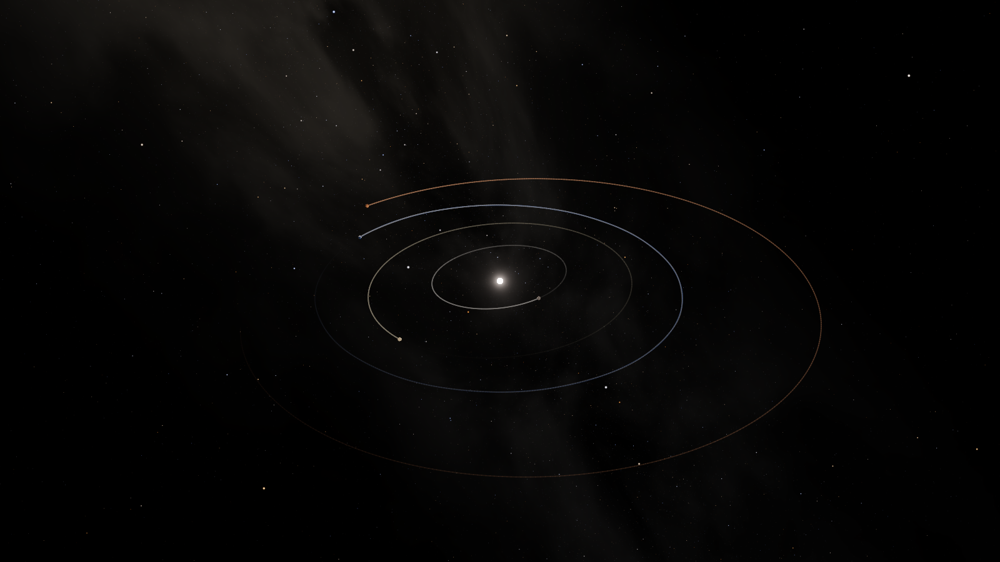
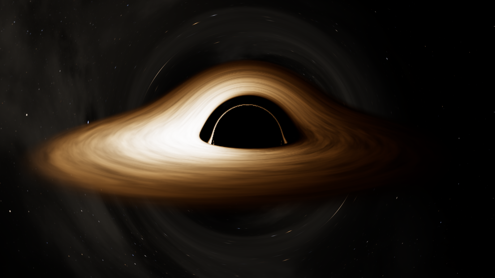
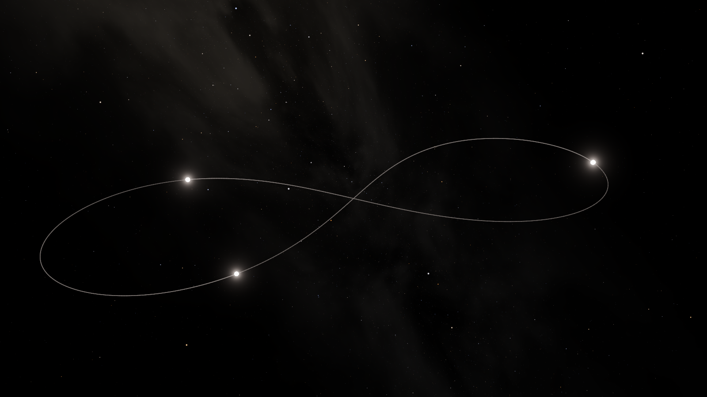
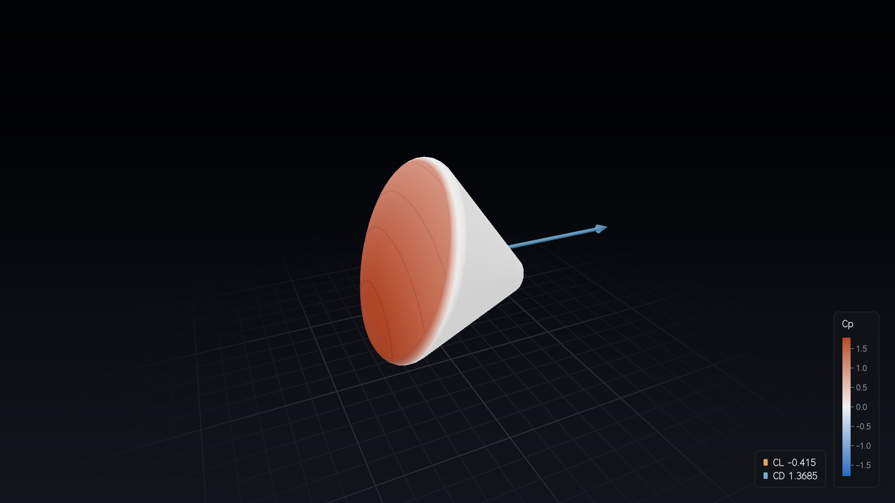
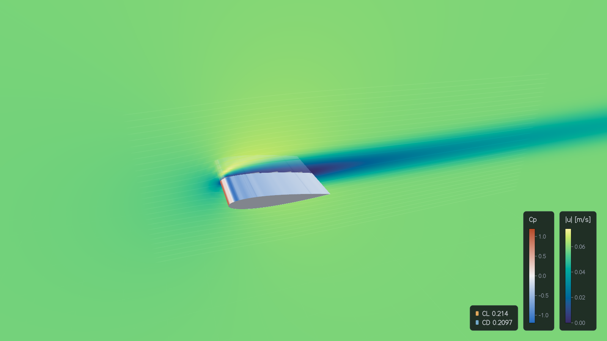
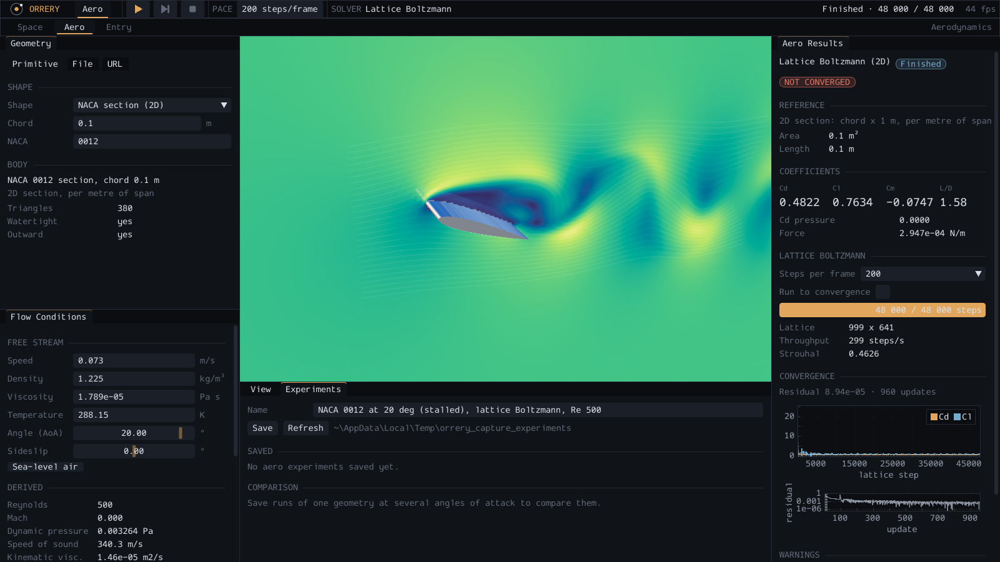
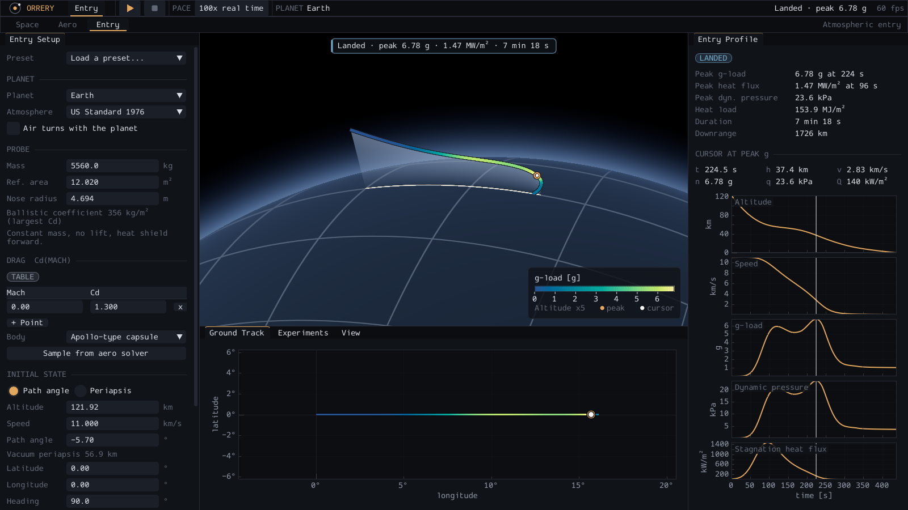

# Orrery

Orrery is a desktop physics laboratory in C++20 with an OpenGL 4.6 front end.
It brings two fields into one application and couples them:

- **Space dynamics**: N-body gravity with symplectic and adaptive integrators,
  black holes (pseudo-Newtonian dynamics, Schwarzschild light bending in the
  renderer), collisions and tidal disruption.
- **Aerodynamics**: flow around a chosen or imported 3D body with three
  solvers for three regimes - lattice Boltzmann, the panel method and modified
  Newtonian theory - giving force coefficients, pressure maps and flow fields.
- **Atmospheric entry**: atmosphere models plus a drag coefficient table
  sampled from the aerodynamic solver drive the entry of a probe through an
  atmosphere.

The aim is an observable, verifiable and deterministic tool, not a game. Every
physical simplification is marked in the code and listed in
[docs/physics.md](docs/physics.md); no solver claims to be validated CFD.

Version 0.0.1. Windows (MSVC 2022) and Linux (GCC 13, Clang 17) are supported;
macOS is out of scope (no OpenGL 4.6).

## Contents

- [Features](#features)
- [Screenshots](#screenshots)
- [Building](#building)
- [Running](#running)
- [Configuration](#configuration)
- [Validation](#validation)
- [Limitations](#limitations)
- [Repository layout](#repository-layout)
- [Documentation](#documentation)

## Features

**Application.** Three workspaces - Space, Aero and Entry - each with its own
main bar, docked panels and camera. Physics runs on its own threads and
reaches the renderer through immutable snapshots, so no frame waits for a
solver. Every run can be saved as an experiment (JSON: inputs, conditions,
solver, result), listed, compared and opened again.

**Space workspace.** Bundled experiments: the J2000 solar system, Sun-Earth-Moon,
the three-body figure eight, Sgr A* with the star S2, and a lone black hole.

- Integrators: leapfrog (kick-drift-kick, default), Yoshida 4th order, IAS15
  (adaptive), RK4 (for comparison); direct summation or a Barnes-Hut octree; the
  Paczynski-Wiita potential near black holes.
- Fixed-timestep accumulator with integral time keeping: the state after N
  steps is bit-identical whatever the frame rate.
- Time warp from 1x to 1e7x. A **time-warp budget** keeps physics within a
  share of wall-clock time: when the requested warp does not fit, the warp is
  lowered to the highest level that does, shown as a `LIMITED` chip and in the
  System Monitor with the requested and achieved warp and the step cost, and
  it comes back when the load drops (with hysteresis, so it does not flicker).
- Panels: Body Inspector (osculating orbit of the selected body), System
  Monitor (energy drift, step time, time warp), Experiment (save and open space
  experiments), Render Settings.
- Rendering: floating origin, logarithmic depth, trails, starfield, HDR with
  ACES tone mapping and an analytic star glare (no bloom pass); black holes with a ray-marched Schwarzschild
  lensing pass and a thin accretion disk with Doppler beaming and
  gravitational redshift.

**Aero workspace.**

- Geometry: parametric primitives (sphere, cube, cylinder, cone, ellipsoid,
  flat plate, wedge, Apollo and Orion type capsules, NACA 4-digit sections and
  wings), import of OBJ, STL, glTF/GLB, PLY and FBX from disk or an https URL
  (size, type and zip limits, SHA-256 cache), unit and orientation
  confirmation, automatic repair with a report. Imported models carry an
  "unvalidated geometry" badge.
- Flow conditions with the derived Reynolds and Mach numbers; the regime
  selector recommends a solver and warns outside its validity range without
  blocking the run.
- Solvers: 2D and 3D panel method, modified Newtonian theory (with a
  Sutton-Graves stagnation heat flux estimate), lattice Boltzmann D2Q9 and
  D3Q19 with a Smagorinsky subgrid model (CPU in the workspace; a GPU compute
  backend exists for the solver library).
- Results: Cd, Cl, Cm with a breakdown and convergence plots; the view shows
  Cp on the body, force arrows, section planes, streamlines, particles and the
  Q-criterion iso-surface. Experiments are compared by angle of attack (lift
  slope) and exported as CSV.

**Entry workspace.**

- US Standard Atmosphere 1976, a mean Mars profile (NASA Glenn fit) and
  exponential atmospheres; Earth and Mars.
- A probe of constant mass, no lift, with a Cd(Mach) table that is edited or
  sampled from the Newtonian solver; IAS15, Yoshida 4 or leapfrog for the
  gravity part of the step.
- Entry Profile panel with altitude, speed, g-load, dynamic pressure and heat
  flux against time, the ground track map, and a 3D view of the trajectory
  coloured by g-load or heat flux. Outcomes: landed, skip-out or orbiting.

**Usability.**

- One keyboard shortcut table for the whole window (Space run or pause,
  `[` and `]` time warp, Ctrl+1/2/3 workspaces, Ctrl+S save, Ctrl+O saved
  experiments, F1 or `?` help overlay, Esc), customisable in the
  configuration file with conflicts detected and reported.
- No silent failure: errors are shown where they happen (status line, the
  panels, a modal with details for import errors); a fatal error writes its
  reason to standard error and to a crash log.
- Colour maps that stay readable for colour-vision deficiencies; the Space
  layout is rendered in tests at 1920x1080, 1366x768 and 1024x640.

## Screenshots

Rendered by the application itself in headless mode (offscreen, no window);
[docs/screenshots.md](docs/screenshots.md) gives the commands that
regenerate them.

| | |
|---|---|
|  |  |
| J2000 solar system after 579 days, with orbit trails | Schwarzschild lensing of a thin disk: shadow, lensed far side, Doppler-bright approaching side |
|  |  |
| Figure-eight three-body choreography (Yoshida 4th order) | Apollo-type capsule at Mach 20 and 20 degrees, modified Newtonian Cp |
|  |  |
| NACA 0012 at 4 degrees, Re 400, lattice Boltzmann: Cp and speed field | NACA 0012 stalled at 20 degrees, Re 500: vortex street in the wake |



Entry workspace after an Apollo-like ballistic entry at 11 km/s: setup,
trajectory coloured by g-load, ground track and the profile plots (peak 6.78 g).

## Building

Requirements: CMake 4.1 or newer, Ninja, a C++20 compiler (MSVC 2022, GCC 13
or Clang 17) and [vcpkg](https://github.com/microsoft/vcpkg) in manifest mode
(`vcpkg.json` lists the libraries: GLFW, glad, Dear ImGui with docking,
ImPlot, glm, Eigen, assimp, libcurl with OpenSSL, miniz, oneTBB,
nlohmann/json, toml++ and Catch2).

Linux:

```sh
export VCPKG_ROOT=/path/to/vcpkg
cmake --preset linux-release
cmake --build --preset linux-release
ctest --preset linux-release
```

Windows, in a Developer PowerShell for Visual Studio 2022 (x64):

```powershell
$env:VCPKG_ROOT = "C:\path\to\vcpkg"
cmake --preset release
cmake --build --preset release
ctest --preset release
```

| Preset (Windows / Linux) | Purpose |
|---|---|
| `release` / `linux-release` | optimised build with the window |
| `debug-asan` / `linux-debug-asan` | debug build with AddressSanitizer (and UBSan on Linux) |
| `ci-headless` / `linux-ci-headless` | the CI build: no window, warnings as errors |

Tests tagged `[gl]` need an OpenGL 4.6 context; they skip without one, or
fail when `ORRERY_REQUIRE_GL=1` is set. Continuous integration builds and
tests Ubuntu with GCC 13 and Clang 17 and Windows with MSVC, runs an
AddressSanitizer job, clang-format, clang-tidy, cppcheck and a check of the
library dependency boundaries (`tools/check_deps.py`).

## Running

```sh
orrery_app                                   # the window, solar system
orrery_app --experiment figure_eight         # a bundled experiment by name
orrery_app --experiment path/to/run.json     # or any experiment file
orrery_app --headless --experiment black_hole --out bh.png --size 1920x1080
orrery_app --headless --experiment solar_system --frame 600 --out solar.png
orrery_app --headless --experiment aero_naca0012_panel --out naca.png
orrery_app --headless --experiment entry_apollo_like --out entry.png
orrery_app --help | --version | --modules
```

- The window opens on the workspace of the experiment (space, aero or entry)
  or of the configuration. Press F1 for the list of shortcuts.
- `--headless` renders one image offscreen and writes a PNG: space
  experiments after `--frame` frames of 1/60 s at the experiment's warp, aero
  experiments after running the solver, entry experiments as the whole
  workspace after the entry has run to its end. It never shows a window but
  needs an OpenGL 4.6 driver; without one it exits with code 3.
- `--benchmark N` prints frame timings (in the window, or after the headless
  image).
- Bundled experiments live in `assets/experiments`: `solar_system`,
  `sun_earth_moon`, `figure_eight`, `sgr_a_s2`, `black_hole`,
  `aero_naca0012_panel`, `aero_naca0012_lbm`, `aero_naca2412_wing`,
  `aero_apollo_capsule`, `entry_apollo_like`.
- Exit codes: 0 success, 1 failure, 2 invalid command line, 3 no OpenGL 4.6
  context.

## Configuration

`config.toml` in the platform configuration directory (Linux
`$XDG_CONFIG_HOME/orrery` or `~/.config/orrery`, Windows
`%APPDATA%\orrery\config`); saved experiments and the crash log go to the
data directory (Linux `$XDG_DATA_HOME/orrery` or `~/.local/share/orrery`,
Windows `%APPDATA%\orrery\data`).

```toml
[paths]
experiments = "/home/me/orrery-runs"
[window]
width = 1600
height = 900
workspace = "entry"        # "space", "aero" or "entry"
[aero]
steps_per_frame = 200
[space]
physics_budget = 0.5       # share of wall time the physics may use
[shortcuts]
save = "F5"
help = ["F1", "?"]
```

Unknown keys and invalid values are reported on standard error with their
line and ignored; nothing is dropped silently. Details:
[docs/app.md](docs/app.md#10-configuration).

## Validation

What is checked against what (all in the test suite; measured values and
their setups are in [docs/physics.md](docs/physics.md) and the documents it
links):

| Area | Reference | Result |
|---|---|---|
| Two-body orbits | analytic Kepler solution | Yoshida4 2.7e-8 AU after 10 orbits; Kepler period to 2.4e-10 |
| Solar system, 1000 years, Yoshida4 | energy conservation | max abs(dE/E0) 1.4e-10 (target 1e-9) |
| Circular orbit, 100 orbits, leapfrog | analytic orbit | 3.8e-7 AU (target 1e-6 AU) |
| Determinism | state hash | bit-identical after the same number of steps, for any frame pacing and with the time-warp budget (which can change how many steps a stretch of wall-clock time takes) |
| Paczynski-Wiita orbits and the ISCO | analytic period; stability at 3 r_s | period error 9e-12; stable above, plunging below |
| Black hole lensing | weak-field deflection series, strong deflection (Bozza 2002), CPU geodesics | within the third-order term; Einstein ring radius matches to 0.01 px |
| Geometry | closed-form volumes and areas | worst relative error 6.1e-14 over 65 checks |
| Sphere voxelization | true sphere | 85184 of 85184 cells agree |
| NACA 0012, 2D panel method | thin-airfoil slope 2 pi per rad; thick-section (Joukowski) values | slope 1.098 x 2 pi (within the 10 percent criterion); Cl within 0.7 percent of the thick-section values |
| AR 6 wing, 3D panel method | Helmbold lifting-line estimate; Trefftz plane | CL within 10 percent; span efficiency 0.988 |
| Apollo capsule, Mach 20, Newtonian | published Cd about 1.3 | Cd 1.367 at the 20 degree trim (5 percent above), L/D -0.30 |
| Cylinder, Re 100, LBM 2D | Strouhal 0.16 to 0.20, Cd 1.2 to 1.5 | St 0.167, Cd 1.468, same on CPU and GPU |
| Sphere, Re 10 to 1000, LBM 3D | Schiller-Naumann correlation, 15 percent | within 1.3 to 10 percent |
| Plate normal to the flow, LBM 3D | Cd about 1.28, 15 percent | Cd 1.158 |
| GPU against CPU lattice Boltzmann | relative L2 below 1e-4 | met after the flow settles (see limitations) |
| US Standard Atmosphere 1976 | published table | layer values to the printed precision |
| Apollo-like entry | peak 6 to 8 g; energy balance within 1 percent | 6.78 g; energy error 2.1e-5 |
| Allen-Eggers ballistic entry | analytic peak deceleration | within 0.5 percent |

## Limitations

- No solver is presented as validated CFD. The panel method is inviscid
  (skin friction is a separate flat-plate estimate), Newtonian theory is
  meant for Mach 5 and above, and the lattice Boltzmann solver is a
  low-Mach method; each warns outside its range.
- During the onset of vortex shedding the GPU and CPU lattice Boltzmann
  solutions differ by up to 7.1e-4 (relative L2), above the 1e-4 criterion;
  they agree again after lock-in ([docs/lbm.md](docs/lbm.md)).
- Frame-rate and throughput figures were measured on one machine (AMD Radeon
  RX 9060 XT); the GTX 1660 class targets of the specification were not
  measured on such hardware.
- Black holes are Schwarzschild only (no spin); the dynamics near them use a
  pseudo-Newtonian potential, not general relativity.
- Entry: constant mass, no lift, no rotation, no ablation; the heat flux is a
  stagnation-point correlation for display.
- The J2000 solar system is ten point masses from JPL Horizons state vectors
  (no asteroids, oblateness or relativity); it drifts from the ephemeris by
  about 1e-6 AU per year.
- The Aero workspace runs the lattice Boltzmann solver on the CPU; large 3D
  lattices are slow there.
- Imported models are not validated; licences of downloaded models are not
  checked (the user is responsible).

## Repository layout

| Path | Contents |
|---|---|
| `src/core` | units, bodies, gravity, integrators, black holes, events (no graphics) |
| `src/geom` | primitives, mesh import and repair, voxelization, panel meshes; `geom/net` for URL downloads |
| `src/aero` | panel method, Newtonian theory, lattice Boltzmann, the compute backend interface |
| `src/atmo` | atmosphere models and the entry dynamics bridge |
| `src/scene` | scenario and experiment formats |
| `src/render` | OpenGL 4.6 renderer, shaders, user interface widgets, GPU compute backend |
| `src/app` | simulation threads, workspaces, configuration, the `orrery_app` executable |
| `tests` | unit, property, validation (`tests/aero_validation`) and golden image tests |
| `assets` | bundled scenarios and experiments |
| `docs` | reference documents and architecture decision records (`docs/adr`) |
| `tools` | `check_deps.py` (dependency boundaries), `check_docs.py` (documentation links and the physics index), `make_screenshots.py` (README images) |

The libraries depend in one direction only: core, geom, atmo and the
simulation side never link OpenGL, GLFW or Dear ImGui (checked in CI).

## Documentation

- [docs/README.md](docs/README.md) - index of every document and decision record
- [docs/physics.md](docs/physics.md) - formula index, sources, approximations and measured results
- [docs/app.md](docs/app.md) - application loop, time-warp budget, workspaces, shortcuts, configuration, error surface
- [docs/rendering.md](docs/rendering.md) - renderer, user interface, golden images
- [docs/aero.md](docs/aero.md), [docs/lbm.md](docs/lbm.md) - aerodynamic solvers
- [docs/aero-workspace.md](docs/aero-workspace.md), [docs/aero-visualisation.md](docs/aero-visualisation.md) - Aero workspace and view
- [docs/atmosphere.md](docs/atmosphere.md), [docs/entry-workspace.md](docs/entry-workspace.md) - atmospheres, entry and the Entry workspace
- [docs/geometry-import.md](docs/geometry-import.md), [docs/url-import-security.md](docs/url-import-security.md) - geometry import and download limits
- [docs/roadmap.md](docs/roadmap.md) - the V1, V2 and V3 roadmap, deferred abstractions and the coupling pattern
- [docs/screenshots.md](docs/screenshots.md) - how the screenshots above are regenerated
- [docs/adr](docs/adr/README.md) - architecture decision records

A Turkish version of this file: [README.tr.md](README.tr.md).
